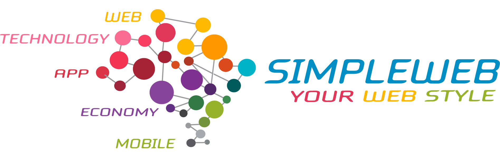

# Unsloth Android app

<p align="center">
   &nbsp;·&nbsp; 
</p>

<p align="center">
  
  
  <a href="https://github.com/simplewebit/unsloth-android/releases/latest"></a>
</p>

<p align="center">
  <strong>Your own Unsloth Studio, in your pocket.</strong><br />
  Chat with the model from your phone, download what it generates, and get a ping when it's done.
</p>

---

**Not an official Unsloth app.** This is a native Android wrapper built on top of [Unsloth Studio](https://github.com/unslothai) by [SimpleWeb](https://www.simpleweb.it).

## What it does

- **Connect anywhere** — point it at the IP or DDNS address of your Unsloth Studio server (saved on the device, default port 8888)
- **The full Studio in a WebView** — the same web app you use on desktop, with a back-to-chat shortcut in the drawer
- **Downloads with progress** — grab files straight from the chat (HTTP and blob URLs), with progress and completion notifications
- **"Reply ready" pings** — a notification when a generation finishes, plus background keep-alive so long generations survive screen-off
- **A debug log you can share** — on/off switch in Options and a one-tap share to attach `crash.log` to an email or a GitHub issue
- **Bilingual UI** — English and Italian, auto-selected from your system language (selector in Options)

## Install

1. Grab the latest APK from the [releases page](https://github.com/simplewebit/unsloth-android/releases/latest).
2. Copy it to your phone and install it (Android will ask you to allow installs from unknown sources).
3. Open the app, enter the IP or DDNS address of your Unsloth Studio server and connect.

Requires Android 7.0+ (minSdk 24). The app is not on the Play Store.

## Build from source

The full source lives in this repo (`app/`, `build.sh`). The build is portable: `build.sh` auto-detects JDK 17, Android build-tools and `android.jar` under `tools/`, generates a keystore if one is missing, and writes the signed APK to `out/Unsloth.apk`.

```bash
bash build.sh
```

## Credits

Developed by **Mattia Di Giuseppe** — [mattia.digiuseppe@simpleweb.it](mailto:mattia.digiuseppe@simpleweb.it) · [simpleweb.it](https://www.simpleweb.it)

Based on [Unsloth Studio](https://github.com/unslothai). Not an official Unsloth app.
